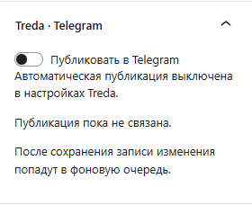
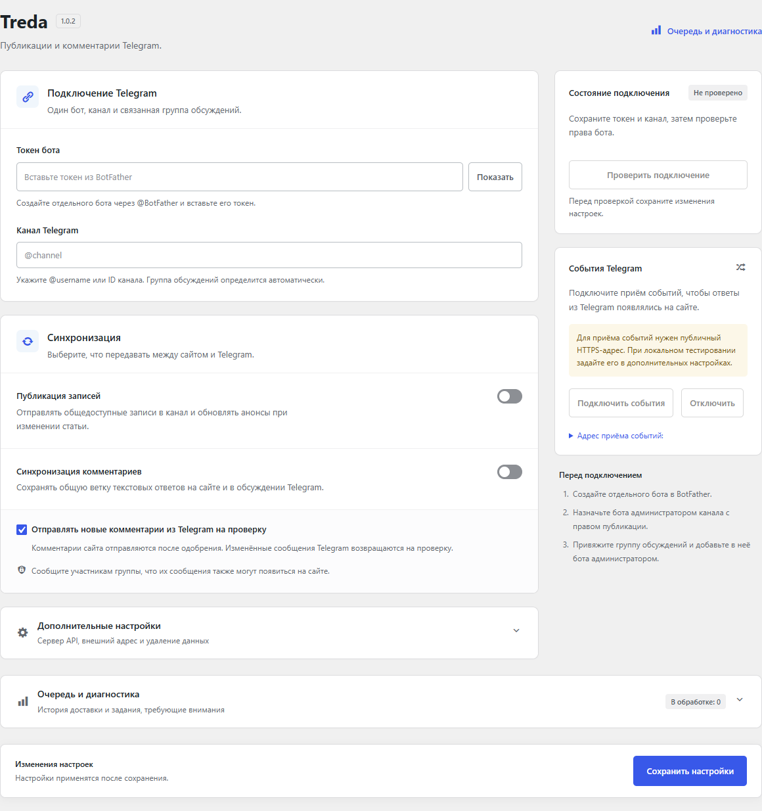

# Treda

Treda связывает публикации WordPress и обсуждения Telegram. Статья получает анонс в канале, а текстовые комментарии и ответы сохраняют общую ветку на сайте и в связанной группе.

Текущая версия — **1.0.4**. Автор — **Ichi-nya**. Лицензия — [GPLv2 or later](LICENSE).

## Возможности

- Публикация анонсов и обновление существующих сообщений при изменении записи.
- Двусторонние текстовые комментарии с сохранением вложенности ответов.
- Имя автора комментария из Telegram и чёрный самолётик рядом ведут к исходному сообщению.
- Стандартная модерация WordPress и защита от повторного импорта и циклов отправки.
- Панель Telegram в блочном редакторе WordPress 7.1 и поддержка классического редактора.
- Фоновая очередь с диагностикой и ручной обработкой неизвестного результата отправки.
- Отдельные настройки HTTPS-сервера Bot API и внешнего адреса webhook.
- Английский и русский интерфейсы.
- Настройки с отдельными блоками подключения, синхронизации и диагностики, адаптацией для телефона и подсказкой о несохранённых изменениях.

Одна установка подключается к одному боту, одному каналу и его группе обсуждений. В этой версии нет Telegram Login, форумных тем, вложений, автоматического импорта истории и команд модерации в Telegram.





## Установка

1. Скачайте **treda-1.0.4.zip** из [Releases](https://github.com/ichinya/wordpress-treda/releases/latest).
2. В WordPress откройте **Плагины → Добавить плагин → Загрузить плагин**, установите ZIP и активируйте Treda.
3. Откройте **Настройки → Treda**, сохраните токен отдельного бота и канал.
4. Назначьте бота администратором канала с правом публикации. Для комментариев привяжите группу обсуждений и назначьте бота её администратором.
5. Включите нужные функции, сохраните настройки и проверьте подключение.
6. Зарегистрируйте webhook, затем проверьте публикацию записи и ответы в обе стороны.

Автопубликация и синхронизация комментариев изначально выключены. Сообщите участникам группы об импорте сообщений на сайт перед его включением.

## Требования

- WordPress **6.2 или новее**; совместимость проверена с веткой **7.1**.
- PHP **7.4 или новее**.
- Таблицы комментариев, метаданных комментариев и связей Treda должны использовать InnoDB.
- Для входящих событий Telegram нужен доступный извне HTTPS-адрес. Настройка внешнего URL не создаёт туннель автоматически.

Для предсказуемой доставки на малопосещаемом сайте настройте серверный запуск WP-Cron. Если результат отправки неизвестен, проверьте Telegram перед ручным повтором: сообщение могло быть доставлено до таймаута.

Если после изменения настроек подключения нужна новая проверка прав бота, опубликованные записи остаются в очереди: фоновый обработчик проверит подключение перед отправкой. Ошибка проверки отображается в диагностике.

Страница согласия на cookie или другой фильтр доступа сайта должны пропускать POST-запросы к `/wp-json/treda/v1/webhook` с действительным секретом Treda. Telegram не отправляет браузерные cookie. На локальном `.local` для обычной доставки webhook необходим доступный извне HTTPS-адрес.

Подробности об обработке данных, правилах модерации, ограничениях API и удалении интеграции приведены в [readme.txt](readme.txt).

## Разработка

Корень репозитория содержит исходники плагина. Для локальной установки разместите их в `wp-content/plugins/treda/`.

Автономные проверки PHP:

```sh
php tests/run.php
```

Проверка синтаксиса JavaScript:

```sh
node --check assets/editor.js
node --check assets/admin.js
```

Интеграционные проверки используют отдельную одноразовую установку WordPress и MySQL с активным плагином и флагом `treda_qa_sandbox`. Они очищают служебные таблицы Treda и создают тестовые записи и комментарии. Запускайте их только на таком стенде:

```sh
wp option update treda_qa_sandbox 1
wp eval-file wp-content/plugins/treda/tests/editor-rest.php
```

Ответы Telegram в автоматических интеграционных проверках подменены; WordPress API, REST-контроллеры и база данных настоящие. Для 1.0.1 пройдены 48 автономных проверок и 81 интеграционная проверка в каждой конфигурации: WordPress 7.1.3 / PHP 8.4, WordPress 7.1.3 / PHP 8.5 и WordPress 6.2 / PHP 8.0. PHP 7.4 проверен статически. Plugin Check 2.1.0 завершился без ошибок и предупреждений.

Для 1.0.2 повторно пройдены 48 автономных проверок, по 81 интеграционной проверке на WordPress 7.1.3 / PHP 8.4 и WordPress 6.2 / PHP 8.0, статическая проверка PHP 7.4+ и Plugin Check 2.1.0, включая проверки во время выполнения. В браузере проверены сохранение токена, переключатели, подсказки, копирование адреса и мобильный вид.

Для 1.0.3 пройдены 48 автономных проверок, по 81 проверке редактора/REST и по 61 проверке подключения/очереди на WordPress 7.1.3 / PHP 8.4 и WordPress 6.2 / PHP 8.0. Из них 53 базовые проверки повторяются в обоих наборах; 8 новых проверок воспроизводят изменение настройки комментариев, обновление проверки подключения и отказ в доступе. Plugin Check и статическая проверка PHP 7.4+ — без ошибок и предупреждений. Отдельно проверены реальные публикации и комментарии Telegram в обе стороны, включая вложенный ответ и повторную доставку события без дубля. На локальном стенде входящие события Telegram передавались в HTTP webhook временным опросным мостом; постоянная доставка через публичный webhook этим тестом не подтверждается.

Для 1.0.4 пройдены 48 автономных проверок и по 53 интеграционные проверки на WordPress 7.1.3 / PHP 8.4 и WordPress 6.2 / PHP 8.0, включая удаление ссылок на Telegram при очистке персональных метаданных. Plugin Check и статическая проверка PHP 7.4+ — без ошибок и предупреждений. Разметка существующего комментария отрисована WordPress и проверена в отдельном браузерном превью: ссылка в имени автора, чёрный значок, отсутствие старой строки источника.

Сборка установочного ZIP через PowerShell:

```powershell
pwsh -File ./tools/build.ps1
```

Архив и SHA256 появятся в `dist/`. Сборка включает только файлы плагина, лицензию и переводы. Тесты, инструменты, документация репозитория и локальные настройки в установочный архив не входят.

Токены и другие учётные данные храните локально, например в `.info/` или в конфигурации сервера. Эти файлы исключены из Git и установочного пакета.
